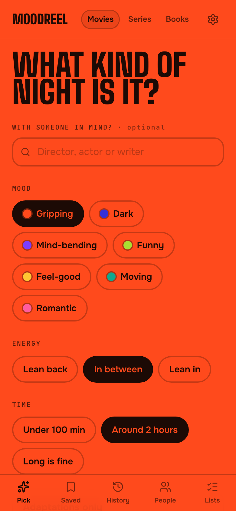
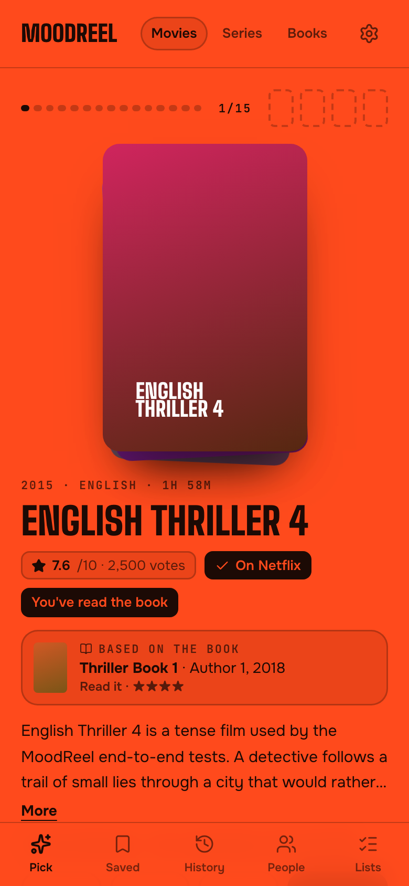
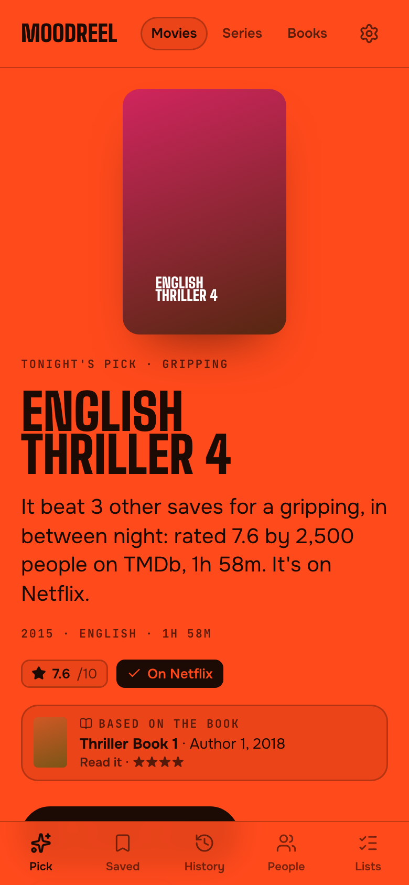
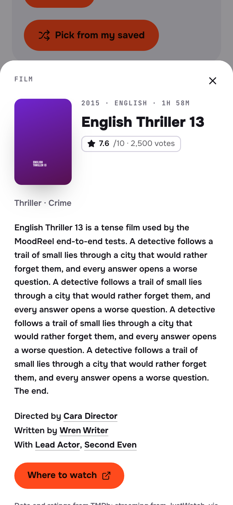
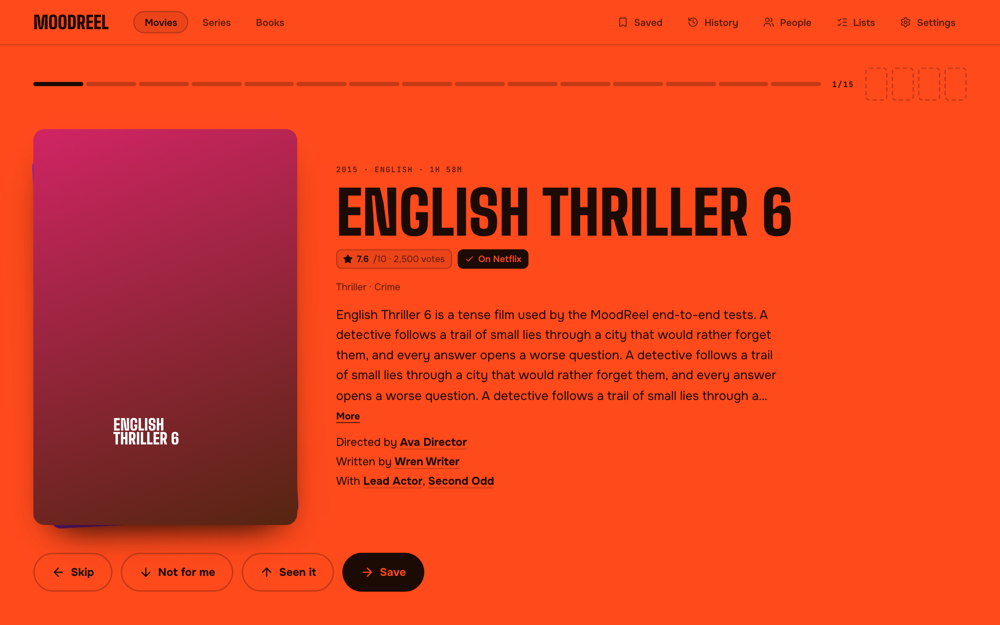
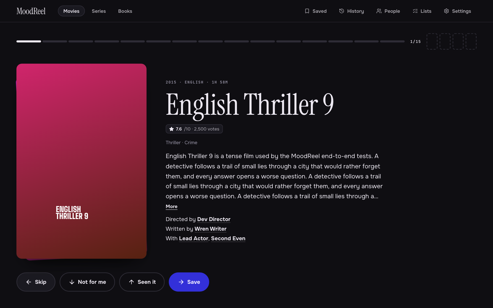
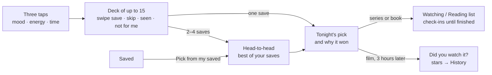

# MoodReel

**What to watch or read tonight, in three taps.** Pick a mood, an energy and a time; swipe a
short deck; let your favourites go head-to-head; get one pick: tonight's film or series, or the
next book.

[](https://github.com/khavyaa/MoodReel/actions/workflows/ci.yml)


<p align="center">
  
  &nbsp;
  
  &nbsp;
  
  &nbsp;
  
</p>

<p align="center"><sub>Screenshots use the test catalogue (made-up titles, no real posters). Refresh them with <code>npm run screenshots</code>.</sub></p>

Built for one person on an iPhone and a Mac. Sign-in is a passkey; there is no sign-up page.

## What it does

- **Films, series and books**, each with its own rules (no soaps, no kids' or self-help books).
- **A deck that learns** from saves, skips, "not for me" and your star ratings.
- **People**: a page of the directors, actors and authors you follow, with photos; follow or
  avoid anyone, mark their work seen or read, or deal a deck from one of them.
- **Lists**: Oscar, Palme d'Or, National Film Award, Booker, Pulitzer and Hugo winners, TMDb's
  top rated, and any film collection, with your progress; follow one to badge its titles in your
  decks, or deal straight from it.
- **Books on screen**: films of books you've read come first, with the book on the card.
- **Cover flow**: Saved, History, lists and people's pages show posters you swipe through, and
  the page takes on the colour of the poster in front.
- **Your library**: Saved and History a page at a time, Watching and Reading, a Details sheet for
  any title, and a way to add what you'd already seen or read: search, or rate a quick stack.

## The moods

<p align="center">
  
</p>

<table>
  <tr>
    <td></td>
    <td></td>
  </tr>
  <tr>
    <td align="center"><sub>Playful (light)</sub></td>
    <td align="center"><sub>Cinematic (dark)</sub></td>
  </tr>
</table>

## How a night works



## Run it locally

You need Node 24+ and Docker.

```bash
docker compose up -d          # Postgres on localhost:5433
cp .env.example .env.local    # fill in BETTER_AUTH_SECRET and OWNER_SETUP_TOKEN
npm install && npm run db:migrate && npm run dev
```

Then open http://localhost:3000/setup, enter your `OWNER_SETUP_TOKEN` and save a passkey.

## Deploy

1. Vercel project → **Storage → Create → Neon** (sets `DATABASE_URL`).
2. Add `BETTER_AUTH_SECRET`, `OWNER_SETUP_TOKEN` and `TMDB_ACCESS_TOKEN`; optionally `NYT_API_KEY` and `CRON_SECRET`.
3. Deploy: migrations run on production builds.
4. Open `/setup` on the production domain and save your passkey.

Architecture, scripts, deployment notes and how every deck is built:
**[docs/how-it-works.md](docs/how-it-works.md)**.

## Credits

This product uses the TMDb API but is not endorsed or certified by TMDb. Where-to-watch data is
provided by JustWatch via TMDb. Book data comes from Open Library. Bestseller data: The New York
Times Books API. Book ↔ film and series links and award winners come from Wikidata (CC0).
