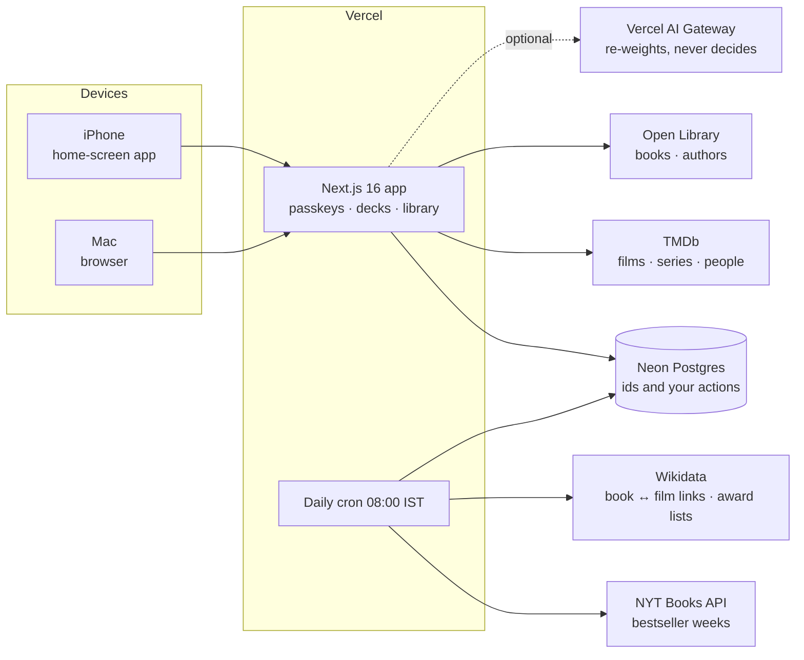

# How MoodReel works

The details behind the [README](../README.md): architecture, scripts, deployment, and the rules
each deck follows. The rules themselves live in code, each with a unit test; this is the map.

## Architecture



Only ids and your own actions are stored; titles, posters and ratings come fresh from TMDb and
Open Library.

## Scripts

| Command | What it does |
| --- | --- |
| `npm run dev` | Development server |
| `npm run build` | Production build (on Vercel, applies migrations first) |
| `npm run lint` / `npm run typecheck` | ESLint / TypeScript |
| `npm test` | Unit tests |
| `npm run test:db` | Auth, schema and taste tests against Postgres (`DATABASE_URL_TEST`) |
| `npm run test:e2e` | Browser tests at laptop and iPhone sizes, against a fake TMDb and Open Library |
| `npm run screenshots` | Regenerate the README screenshots from the test catalogue |
| `npm run db:generate` | Create a migration after changing `lib/db/schema` |
| `npm run db:migrate` | Apply migrations to `DATABASE_URL` |

CI runs lint, types and all three test suites on every push, against a throwaway Postgres.

## Making changes

`main` is the stable version; production deploys from it. All work happens on a branch
(`feat/…`, `fix/…`, `chore/…`) and goes in through a reviewed pull request. CI (lint, types,
unit, database and browser tests) runs on every PR.

## Deploy (Vercel + Neon, free tiers)

1. In the Vercel project, **Storage → Create → Neon** and connect it. This sets `DATABASE_URL`.
   With a database branch per preview deployment (the integration's Preview setting), each
   preview gets its own copy of production and never touches live data.
2. Add `BETTER_AUTH_SECRET`, `OWNER_SETUP_TOKEN` and `TMDB_ACCESS_TOKEN` (Production and
   Preview). For book bestsellers, also `NYT_API_KEY` and `CRON_SECRET` (optional). AI needs
   nothing: on Vercel the AI Gateway authenticates itself. Locally, set `AI_GATEWAY_API_KEY` to
   try it, or leave it unset and the rules do everything.
3. Deploy. Migrations run during production builds only; pull-request previews run on their own
   Neon branch, which is never migrated. Neon's free plan allows 10 branches: when a new
   branch's preview fails at once with "Resource provisioning failed", delete the `preview/…`
   branches of merged PRs in the Neon console. To keep it from filling, set the project's
   Deployment Retention Policy short for previews (here: pre-production, errored and canceled
   deployments 1 day, production 30 days); Neon deletes a preview's branch with its deployments.
4. Open `/setup` on the production domain and save your passkey.

Passkeys are bound to the domain they were created on. One made on production won't sign in on
a preview deployment's own URL; previews are for checking builds.

## How a film deck is picked

1. **Pools.** TMDb Discover, per language (English, Hindi, Tamil, Malayalam), filtered by the
   mood's genres or keywords, your runtime limit, and a per-language vote floor. Separate pools
   pull what's on your services (set in Settings; Netflix, Prime Video, Apple TV and JioHotstar to
   start) and well-rated films fewer people have seen.
2. **Your rules.** English: any genre. Tamil, Malayalam, Hindi: only crime/thriller/mystery, or
   acclaimed. Each mood also rules some genres out whatever else fits: Funny deals no crime
   films or thrillers (TMDb files dark crime films as comedies too), nor family, horror or war. Anything you've seen, marked "Not for me", saved or picked never returns; skips
   return after 60 days.
3. **Score.** Weighted rating (new releases damped), mood fit, energy fit, taste learned from your
   swipes and star ratings, a bonus for your services, and a markdown for films everyone has seen.
   No raw popularity.
4. **AI pass (optional).** The top 30 go to a fast model through Vercel's AI Gateway, which flags
   which genuinely fit the mood. It only re-weights; if it's slow or unavailable, the rules decide.
5. **Deck.** Every film is checked against your time once its details are in (TMDb's own
   runtime filter lets long films through, and followed people's or read books' films skip it).
   15 films, about two-thirds English, the rest spread through, with Hindi, Tamil and Malayalam
   taking turns for those slots when films in more than one fit. Swipe right to save,
   left to skip, up for seen it, down for not for me; Undo steps back as far as you like. Four
   saves start the head-to-head.
6. **After the pick.** About three hours later the films start screen asks "Did you watch it?":
   watched (with optional stars) counts as seen, "Not yet" puts it back in Saved, "Skipped it"
   stops asking. Only your latest unanswered pick is asked about. The start screen checks for a
   due question when it loads, when you come back to the app after a minute or more (the
   home-screen app resumes rather than reloads), and on "Start again"; series and book check-ins
   work the same way.

The rules live in `lib/taste/rules.ts`, each with a unit test, and their thresholds came from
probing real TMDb data.

## How a series deck differs

- **Languages:** English, and Hindi of any genre when it's well rated (weighted 7.2+). About one
  show in four is Hindi. Hindi is a small pool on TMDb (about 120 shows with 15+ votes).
- **Never:** soaps, talk, reality, news, kids' shows or animation. Hindi is short series only
  (50 episodes or fewer, at most 5 seasons, about 12 episodes a season at most), which also keeps
  out daily soaps that TMDb files as drama. Docuseries and older classics are in.
- **Moods** map onto TMDb's TV genres, which differ from film genres. English mind-bending uses
  story keywords (time loop, dystopia, parallel world…) because "Sci-Fi & Fantasy" alone dealt
  teen supernatural shows. There's no romantic mood: TV has no romance genre.
- **Commitment** replaces time: mini-series (one finished season), one season (season 1 of 13
  episodes or fewer), long-runner (three seasons or more). It needs each show's details, so the
  best 40 English and 16 Hindi candidates are checked before the deck is composed. Energy also
  leans on episode length: half-hour episodes suit "lean back".
- **After the pick** a series goes on your Watching list. Every three days the series screen asks
  "Still watching?": finished (with optional stars) moves it to History, dropped counts like
  "not for me".

Series rules live in `lib/taste/series-rules.ts`.

## How a book deck works

- **Catalogue:** Open Library (free, no key): subjects, page counts, covers, and reader ratings out
  of 5. Its ratings are thin (a famous book has a few hundred), so quality also uses how many
  people logged it as read and NYT weeks.
- **Bestsellers:** the New York Times lists. A daily Vercel cron (`/api/cron/nyt`) syncs the adult
  fiction and non-fiction lists into the database, about two years back, and matches each ISBN to
  its Open Library work. Weeks on the lists count towards quality, and lasting bestsellers join the
  pool even with few Open Library ratings. Without `NYT_API_KEY` this is skipped; Open Library's own
  NYT subject tags still give a smaller signal. Settings → Background syncs shows how the last run
  went (Vercel's Hobby plan keeps function logs for only an hour).
- **Never:** children's and young adult, romance and romantasy, self-help and business, comics and
  graphic novels (including ones only tagged with a comics class code), box sets, title sets and
  omnibuses.
- **Mix:** English only, mostly the last 30 years, at most two classics and one book per author in
  a deck. Length replaces time: short (under 250 pages), medium, long (450+).
- **Clean-up:** works filed under a foreign title get their English edition's title, messy edition
  titles are tidied, and descriptions that aren't in English are dropped. Author pages drop sets,
  adaptations, textbook editions and duplicate records, and don't show impossible years.
- **After "Read next"** a book goes on your Reading list. About once a week the books screen asks
  "Still reading?": finished (with optional stars) moves it to History, gave up counts like "not
  for me". "Where to get it" searches Amazon India's books.

Book rules live in `lib/books/rules.ts`.

## People, books on screen, details, offline

**People.** Directors, creators, writers and lead actors (TMDb) and authors (Open Library) are
tappable on every card. Follow someone and their unseen work joins your decks (skipping the
"everyone has seen it" markdown, at most two per person and four per deck) with a badge; avoid
someone and nothing of theirs is dealt. "Deal from …" (a person's page, the start screen's
search, or the People page) makes a deck from all of their work, not only the best-known titles
their page lists. People you keep loving (three titles, four for actors) are suggested. Rules:
`lib/people/rules.ts`.

**Books on screen.** Which films and series are based on which books comes from Wikidata (TMDb ids
P4947/P4983, "based on" P144, Open Library id P648), synced weekly by the same cron; on other days
the cron moves links off Open Library works that have since been merged. A film whose credits name
the novel's author ("Novel" job) but has no link is matched on Open Library by title and author,
and the link is kept. The pull is one way: a film or series of a book you've read ranks higher
(more if you rated the book well, at most three per deck) with a "You've read the book" badge,
while a book you know from the screen ranks well down. "Adaptations only" on the start screen
deals only films or series based on a book. Cards, the pick screen ("I've read it"), Saved and
History show the link, and Settings → Background syncs shows the last sync. Rules:
`lib/adaptations/rules.ts`.

**People page.** People in the nav lists who you follow and avoid, with photos (TMDb profiles,
Open Library author photos, initials when there's none), suggestions, and one search across
film and series people (TMDb) and authors (Open Library). People you follow or avoid come up
from the first letter; each source's results show as soon as they arrive (TMDb answers in a
fraction of a second, Open Library can take a few), and the last results stay up while you keep
typing. On a person's page every title has Seen it / Read it beside Save.

**Lists.** Lists in the nav: award winners from Wikidata (Oscar Best Picture, Palme d'Or,
National Film Award for Best Feature Film, Booker, International Booker, Pulitzer for Fiction,
Hugo for Best Novel; P166 with TMDb or Open Library ids), synced weekly by the cron into
`list_items` and filled on the spot the first time a list is opened; TMDb's top rated films and
series (Discover by rating with a vote floor, since `/top_rated` lets in barely voted titles);
and any TMDb film collection, found by search or from the films you've seen. Each shows your
progress and pages of 24, with Seen / Save on every title. Follow a list and its unseen titles
join your decks like a followed person's work (a small boost, sharing the cap of three with books
you've read) with an "On …" badge. "Deal from this list" makes a deck of only its titles you
haven't seen, saved or turned down, within your time, best fit for the mood first; your language
rules don't apply, but the mood's exclusions do, and titles that don't fit the mood at all are
left out unless none do. IMDb's lists, AFI 100, Sight & Sound and the 1001 books aren't
available: there's no free API and Wikidata doesn't hold them. Code: `lib/lists/`.

**Adding what you've already seen or read.** History → "Add what you've already seen or read":
search films, series or books and mark them seen with optional stars, or rate a quick stack of
the most-watched films (English with Hindi, Tamil and Malayalam), series or books, swiping Seen,
Not for me or Haven't seen. Both count like a seen title with its rating.

**Library pages.** Saved and History show 24 titles a page with page numbers; Saved filters by
films, series or books in the address, so Back returns to the same page. Rating a title updates
it in place, without reloading the page.

**Details.** Any title in Saved, History (Picks and Seen & read), Watching/Reading, the pick screen
or a person's page opens a Details sheet: the full synopsis, length, rating and its scale (/10
TMDb, /5 Open Library), people, the linked book or film, and where to watch or get it.

**Offline.** Offline, swipes, saves and check-ins wait and are sent when the connection returns
(Next's `useOffline`), and a banner says so. A save that fails for another reason says so, with
Retry. A service worker (`public/sw.js`, production only) lets the home-screen app open with no
connection: Saved, History and the start screens open from your last visit, anything else shows
`/offline`. Kept pages live on the device only and are deleted on sign-out.

**Looks.** Bold & playful in light mode, cinematic dark in dark mode, following the device. An
override is stored per device in the browser and applied before the first paint.

**Cover flow and poster tint.** Saved, Watching/Reading, History (Picks and Seen & read), list
pages, a person's page and the people you follow show titles as a cover flow
(`components/flow/cover-flow.tsx`, built on Motion): one poster in front, neighbours tilted
away, moved by swiping, the arrows, the arrow keys or tapping a side poster, with springy
settling. What's under each poster stays mounted, so its buttons keep their state as you
browse; the page numbers below a flow still move 24 at a time. The page takes a soft tint of the
poster in front: its colour is sampled in the browser from a small copy of the image
(`lib/tint.ts`; TMDb and Open Library allow it), made rich enough to tint with, and fed to
`.tint-frame` in `globals.css`, which re-points the tokens (pale wash in playful, tinted dark
in cinematic). If an image can't be read the page keeps its normal look. Picking keeps the mood
colour (the start screen, the deck and the head-to-head), with two touches of the poster: a soft
glow of the top card's colour behind the deck, and tonight's pick, where the page fades from the
mood into the winner's own colour while its poster settles in (the mood keeps a dot beside its
name). Colours come from the poster's strongest hue family, so a poster of two opposite colours
reads as one of them rather than grey. Reduce Motion swaps the tilt and springs for quick fades.

## Code map

```
app/(auth)/        sign-in and one-time setup
app/(app)/         everything signed in: /movies, /series, /books, saved, history, people, lists, add, settings
app/api/auth/      Better Auth endpoints
app/api/cron/      the daily NYT sync and weekly Wikidata syncs (Vercel cron, guarded by CRON_SECRET)
lib/auth.ts        passkey-only, single-owner auth
lib/session.ts     the data access layer: every read of your data verifies the session here
lib/db/            Drizzle schema and client (plain Postgres, no vendor lock-in)
lib/moods.ts       moods, energy and time vocabulary, and their colours
lib/taste/         language gates, weighted rating, mood/energy fit, taste from swipes and ratings
lib/deck/          deck composition, head-to-head, AI re-weighting, the film, series and book builders
lib/tmdb/          TMDb client (retries and deadlines), movie, series, people and provider queries
lib/books/         Open Library client, NYT bestseller sync, book rules
lib/people/        follow / avoid / suggest rules, a person's work, decks from one person
lib/adaptations/   book ↔ film/series links: Wikidata sync, ranking rules, links on cards
lib/lists/         award lists, TMDb top rated and collections: catalogue, sync, progress, list decks
lib/ai/            AI Gateway calls, each with a rule-based fallback
components/pick/   the flow: taps, deck, head-to-head, pick, save status
components/library/ Saved, History, pages, adding what you've seen, Details sheet
components/people/ the People page, search, photos, follow / avoid / seen controls
components/flow/   the cover flow and the poster tint behind it
components/lists/  follow a list, progress, collection search
proxy.ts           sends signed-out requests to /sign-in
```

**Data.** Titles are keyed by media, source and external id, since TMDb movie and TV ids
overlap. Only ids and your own actions are stored; details come fresh from TMDb and Open
Library.

**Portability.** Nothing is Neon-specific. Moving to a self-hosted Postgres means changing
`DATABASE_URL`, then exporting and importing the data.
